## Lab:

- Sin firewall
- Sin IDS ni IPS
- Sin origen de trafico externo
- Sin protocolo de enrutamiento dinamico
- Dos routers, dos rutas estaticas, un shutdown

---

## Lo que este lab demuestra

> Dos rutas estaticas simetricas hacia una red no conectada producen un bucle de enrutamiento con agotamiento de TTL, sin ningun origen externo.
> (Porque decrementa y porque el bucle termina en descarte) [RFC 1812 Section 4.3.2 TTL](https://www.rfc-editor.org/info/rfc1812/#section-4.3.2)

La causa raiz del incidente real sigue abierta; esto es una hipotesis del mecanismo, no la configuracion real de la FAA. El segmento "migrado" en este modelo es un solo cable, no una migracion completa de cobre a fibra.

## Topologia

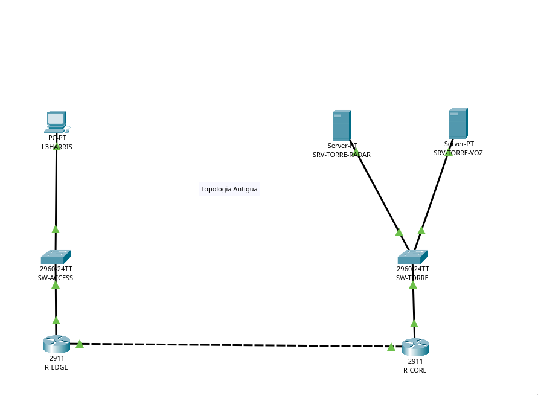

## Direccionamiento

| Equipo          | Interfaz | IP            | Mascara | Estado          |
| --------------- | -------- | ------------- | ------- | --------------- |
| L3Harris        | Fa0      | 192.168.10.10 | /24     | gw 192.168.10.1 |
| Srv-Torre-Radar | Fa0      | 172.16.0.12   | /24     | gw 172.16.0.1   |
| Srv-Torre-Voz   | Fa0      | 172.16.0.11   | /24     | gw 172.16.0.1   |
| R-EDGE          | G0/0     | 192.168.10.1  | /24     | up              |
| R-EDGE          | G0/1     | 10.0.0.1      | /30     | up              |
| R-EDGE          | G0/2     | 172.16.0.1    | /24     | down (shutdown) |
| R-CORE          | G0/0     | 10.0.0.2      | /30     | up              |
| R-CORE          | G0/2     | 172.16.0.2    | /24     | down (shutdown) |

## Comunicacion con los servidores de Voz y Radar

#### Tower-radar

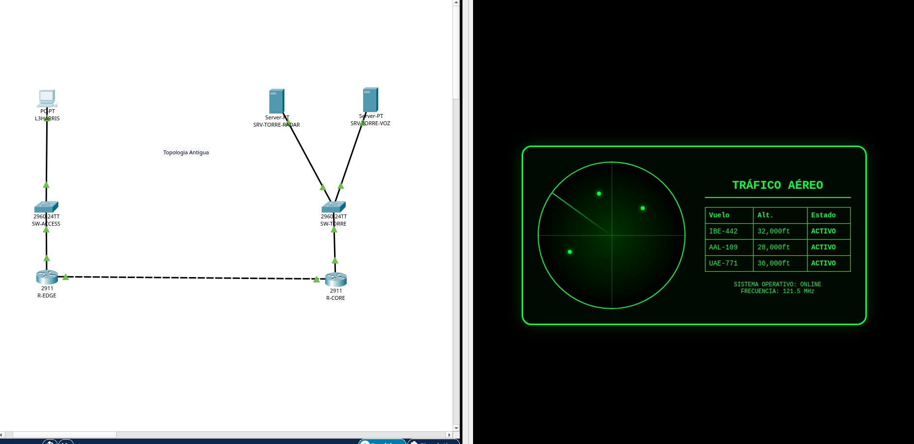

#### Tower-Voz

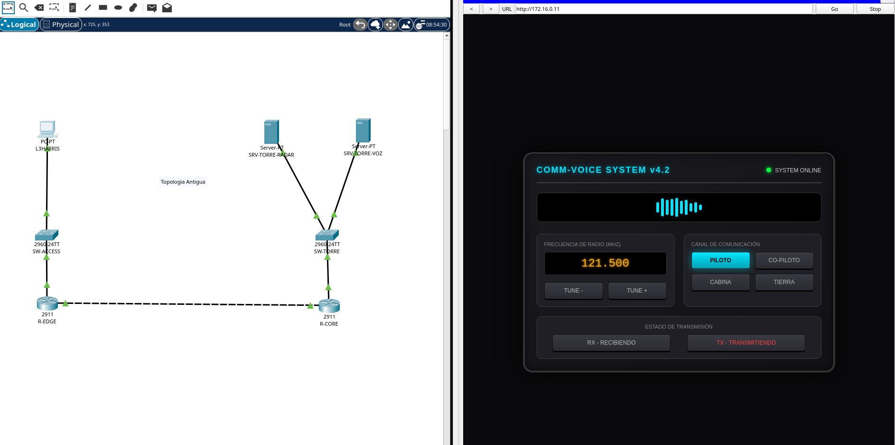

## Tracert

El primer paquete sale con TTL 1 y muere en la puerta de enlace, asi que el salto 1 es 192.168.10.1 (R-EDGE).

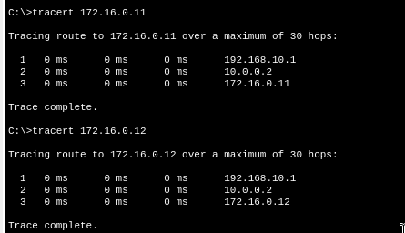

---

# Migracion (Simulacion del Fallo de Configuracion)

**OJO: En el mundo real de Cisco, hay una regla: la "Ruta Conectada" siempre gana.**

Si el R-EDGE tiene el cable conectado al SW-TORRE y la interfaz tiene una IP activa, el router diria: "¿Para que voy a usar la ruta estatica que me manda al R-CORE si yo tengo el cable conectado aqui mismo?".
El paquete llegaria a los servidores y no habria bucle. Es por eso que lo conecto como ven en la captura, pero lo dejo en **shutdown**.

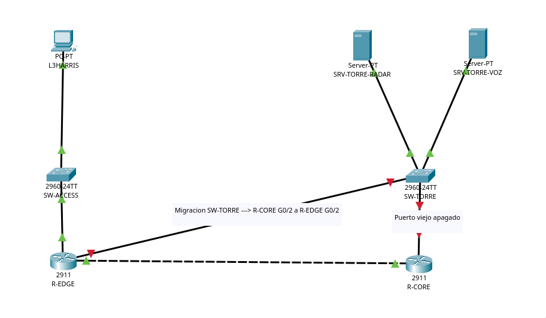

**Por que es necesaria la migracion?**
Necesitamos pasar de cobre a fibra, por lo que debemos reemplazar la funcion del R-CORE por el R-EDGE, como vemos en la imagen. Pero, ¿que pasa con la configuracion?

**Configuracion del R-EDGE (Nuevo router):**
Recordemos que en nuestra _Fase-A_ el router ya tenia su ruta estatica con el R-CORE... y era asimetrico claramente porque el R-CORE era el que se comunicaba con los servidores. Ahora eso ya no pasa, el R-EDGE tiene que ser directo... Y aqui esta el problema: la configuracion no es directa, sigue siendo simetrica.

```cisco
! Estamos diciendo: oye, para llegar a la red 172.16.0.0 manda el paquete al 10.0.0.2 (R-CORE)
R-EDGE# ip route 172.16.0.0 255.255.255.0 10.0.0.2

! Y cuando llega al R-CORE, este dice lo mismo: manda al .1 para llegar a la red 172.16.0.0
R-CORE# ip route 172.16.0.0 255.255.255.0 10.0.0.1
```

¡Y nooo! Los paquetes entran en bucle y mueren...

### Try to connect to their Websites :(

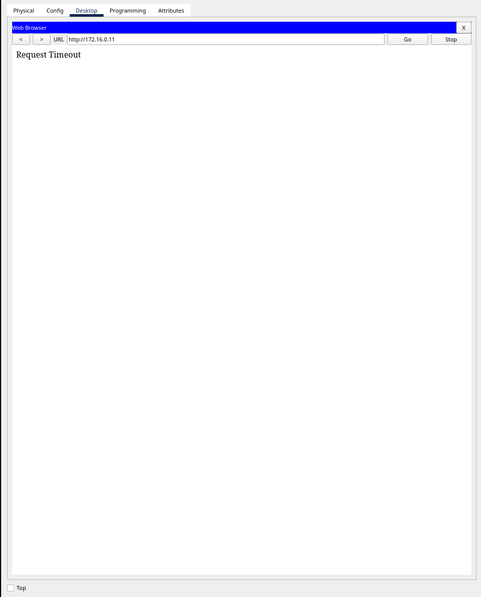

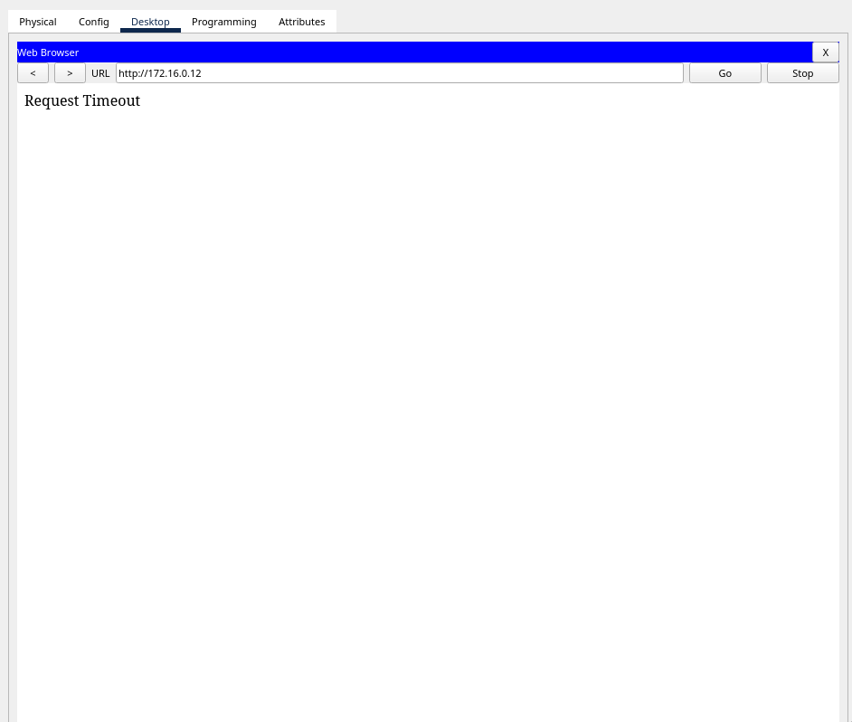

### **Tracert 172.16.0.12**

Con el `tracert` queremos ver los hops de cada paquete. El resultado nos devuelve saltos desde el Gateway hasta el R-CORE repetidamente.

El paquete sale de la PC, llega al Gateway (R-EDGE), pero en lugar de ir a los servidores de la torre, el R-EDGE lo manda al R-CORE, y el R-CORE lo devuelve al R-EDGE. Estamos viendo en tiempo real un bucle de enrutamiento. El paquete esta atrapado en un ping-pong infinito y nunca llegara a su destino, consumiendo recursos de la red hasta que el TTL expire (30 hops).

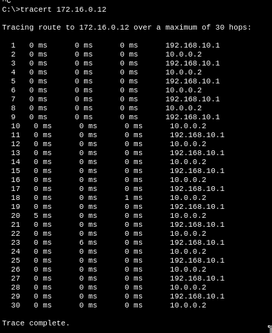

### **Ping 172.16.0.12**

- TTL Inicial: 128
- TTL Final: 1 -> Time Exceeded

Debemos tener en consideracion que cuando un router mata un paquete con TTL: 1, el router crea un nuevo paquete para avisarle al Host (PC) que el paquete original murio. Este nuevo paquete tiene un TTL: 255. Este justamente es el mensaje de **ICMP Time Exceeded**.

La imagen que vemos muestra como el ICMP es el mensaje que le dice a la PC: "El paquete que mandaste murio en R-CORE".

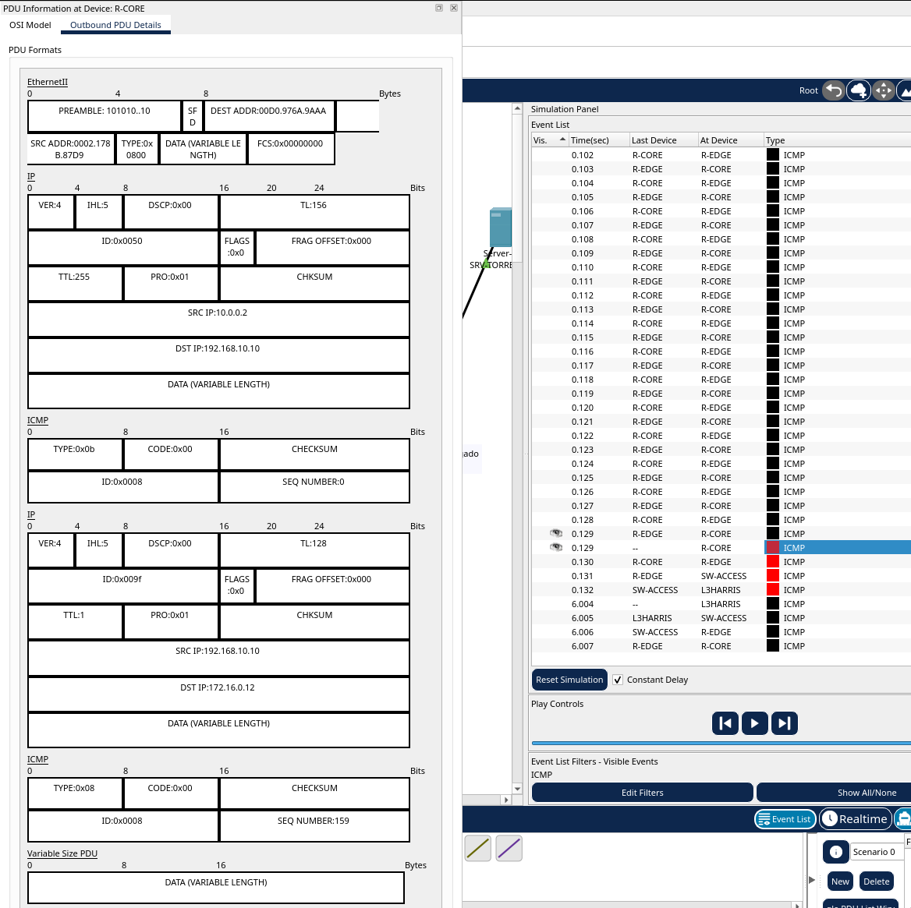

Cabe mencionar que esto nos muestra como funciona la herramienta `tracert`, ya que lo que hace es enviar paquetes con TTL 1, luego TTL 2, etc., precisamente para forzar que los routers generen estos mensajes de "Time Exceeded". El tracert simplemente anota quien envio el mensaje de muerte y asi sabe por donde paso el paquete (Hops).

### **Saturacion de interfaces en R-EDGE G0/1**

Mientras hacemos el ping, vemos como suben los contadores (se satura... :0).

**Packets Input** y **Packets Output**:
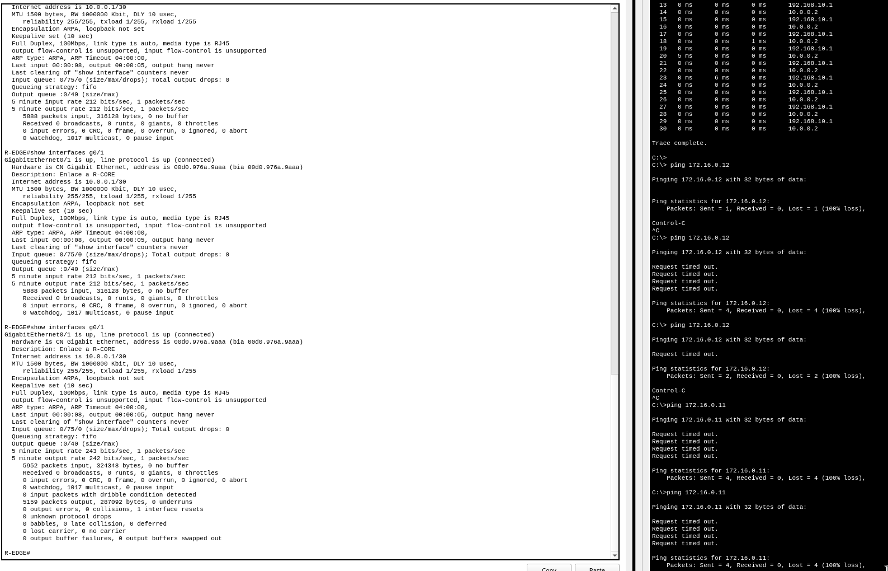

# Arreglo del bucle (Tranquilo!)

Una linea sola lo arregla. Estando en el contexto de esta practica puede parecer obvio, pero eso mismo causo una caida monumental en segundos.

```cisco
R-EDGE# interface g0/2
R-EDGE# no shutdown
R-EDGE# ip addr 172.16.0.1 255.255.255.0
end
write
```

No necesitamos borrar las rutas estaticas ya que la **ruta conectada** tiene distancia administrativa 0 y desplaza a la estatica que tiene AD 1.

### **Verificacion**

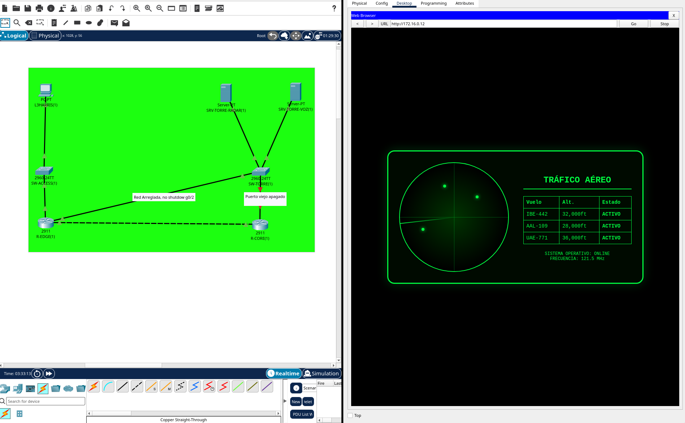
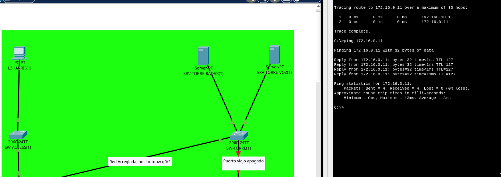

**Veamos que el fallo no es la ruta en si, sino que la interfaz del nuevo router no estaba prendida al momento de hacer la migracion:**

```cisco
R-EDGE#show run | include ip route
ip route 172.16.0.0 255.255.255.0 10.0.0.2
ip route 0.0.0.0 0.0.0.0 10.0.0.2
R-EDGE#
```

# Observaciones

El emisor del Time Exceeded alterna entre 10.0.0.2 y 10.0.0.1. En el Flood (Lab 2A) no existira un Time Exceeded: el paquete se descarta por cola llena antes de agotar el TTL.

**Laboratorio 2**
Con este laboratorio voy a jugar mas. Ojo, la situacion es hipotetica y me servira para hacer una comparativa con el Flood y con la inyeccion de rutas con un router externo. Algo que debemos tener claro es que el hecho de que una red sea una _Intranet_ no significa que sea segura; igualmente es hackeable.

- [Lab 2 ataque hipotetico](../02-lab-ataque-hipotetico/notas.md)
